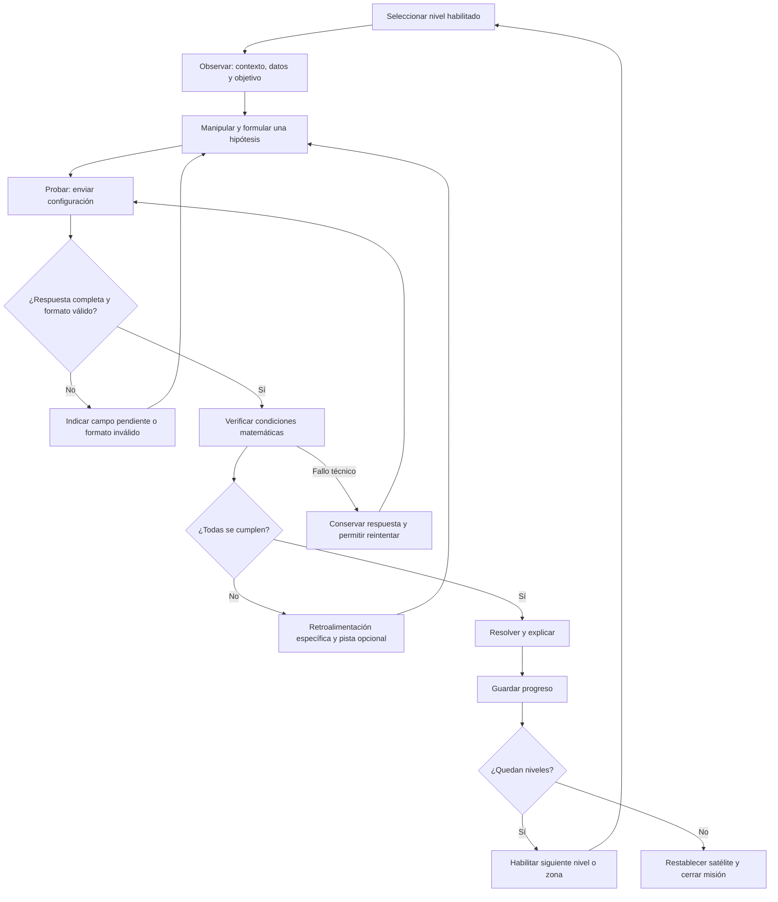

# DOCUMENTO DE DISEÑO DE JUEGO (GDD): FUNctions

**Versión:** 0.1  
**Fecha:** 16 de noviembre de 2026  
**Estado:** diseño y reglas aprobados por el equipo; implementación y pruebas pendientes.

Este GDD sigue la estructura solicitada basada en la plantilla de Baldwin. Adopta las cinco zonas y los quince ejercicios del banco canónico del proyecto. Las reglas de ayudas, progreso, controles y presentación aquí definidas son decisiones definitivas y aprobadas. Su aprobación no constituye evidencia de que ya estén implementadas o probadas. El nombre definitivo es **FUNctions**.

## 1. Visión General del Juego (Game Overview)

### 1.1. Centro del Juego (Promesa principal)

**Repara los cinco sistemas de un satélite manipulando conexiones, gráficas y parámetros para descubrir cómo funcionan las funciones matemáticas, comprobar tus hipótesis y convertir cada error en una nueva estrategia.**

### 1.2. Concepto General y Género (Puzzle 2D Educativo)

FUNctions es un puzzle educativo 2D para un jugador, organizado en paneles interactivos de un centro de control espacial. La persona jugadora asume el rol de especialista de sistemas de **ESAI (El Salvador Aerospace Institute)**, representado de forma ficticia dentro del juego, y recupera un satélite cuyos módulos procesan datos de forma incorrecta.

Cada reparación plantea un problema matemático contextualizado: conectar una entrada, delimitar valores permitidos, ajustar una trayectoria o recuperar una señal. El contenido se representa simultáneamente mediante objetos manipulables y notación matemática; las acciones modifican la relación o función que se estudia.

El aprendizaje se organiza mediante **PBL —aprendizaje basado en problemas—**: diagnosticar una falla, proponer una solución, experimentar y justificarla mediante la retroalimentación. La gamificación utiliza objetivos de misión, progreso visible y recuperación de sistemas. La dificultad procede del razonamiento, con reintentos ilimitados y sin temporizador ni pérdida de vidas.

**Plataforma objetivo propuesta:** navegador en computadora y tableta, interfaz en español, compatible con mouse y pantalla táctil. PixiJS para diagramas de nodos y Mafs/SVG para gráficas son referencias técnicas del banco; el diseño no depende de un motor específico.

### 1.3. Audiencia Objetivo

- **Principal:** estudiantes de bachillerato, aproximadamente de 15 a 18 años, que comienzan o refuerzan el estudio de funciones.
- **Secundaria:** estudiantes de ingreso universitario que necesitan repasar estos conceptos.
- **Prerrequisitos:** operaciones aritméticas, despeje básico, pares ordenados, conjuntos y lectura inicial del plano cartesiano. Los intervalos y controles reciben recordatorios dentro de los retos.
- **Uso previsto:** trabajo individual en clase o práctica autónoma; una zona puede funcionar como una sesión breve.
- **Duración estimada de diseño:** 45–75 minutos para el recorrido completo, ajustable tras pruebas con estudiantes; no constituye un límite de juego.

### 1.4. Resumen de Flujo de Juego (Game Flow Summary)

1. Iniciar o continuar la misión y consultar el estado del satélite.
2. Entrar en la zona habilitada y leer el diagnóstico del sistema.
3. Observar la representación matemática y reconocer la condición que debe cumplirse.
4. Manipular controles, anticipar el resultado y pulsar **Probar**.
5. Interpretar la retroalimentación, solicitar pistas si hace falta y corregir la propuesta.
6. Resolver el reto, revisar una explicación breve y continuar.
7. Completar los tres retos de la zona para restaurar un sistema y habilitar la siguiente.
8. Resolver E15 y completar los quince retos para restablecer el satélite.

### 1.5. Estilo Visual y Atmósfera (Look and Feel)

**Dirección visual:** centro de control retrofuturista 2D, con paneles modulares, diagramas limpios y cuadrículas cartesianas. Fondo azul oscuro, superficies de alto contraste, cian para elementos manipulables y ámbar para atención. Cada estado incluye texto o icono; el color nunca comunica por sí solo.

**Jerarquía:** primero el problema y sus datos, después la representación manipulable y finalmente la decoración. Las ecuaciones, coordenadas y extremos de intervalos permanecen legibles. Los ejes indican escala y las curvas incluyen señales de continuidad fuera de la ventana visible.

**Estética emocional:**

| Emoción buscada | Recurso de diseño |
|---|---|
| Curiosidad | Fallas breves que plantean una pregunta observable: «¿Por qué esta entrada produce dos salidas?» |
| Descubrimiento | Cambios sincronizados entre controles, ecuación y gráfica. |
| Seguridad para experimentar | Deshacer, reiniciar y recibir explicaciones sin penalización. |
| Satisfacción y competencia | Recuperación visual de un módulo al demostrar la condición matemática. |
| Autonomía | Pistas voluntarias y posibilidad de volver a retos resueltos. |

Las animaciones son breves y reducibles; los errores utilizan una señal discreta, no alarmas persistentes.

### 1.6. Alcance del Proyecto (Zonas y número de niveles)

**Recorrido inicial: cinco zonas, tres niveles por zona, quince niveles en total.** Cada nivel corresponde a un ejercicio E01–E15 del banco canónico.

| Zona | Sistema recuperado | Niveles |
|---|---|---|
| 1. Máquina de Enlaces | Distribución de energía y datos | E01–E03 |
| 2. Escáner de Proyección | Sensores y límites de operación | E04–E06 |
| 3. Sintonizador de Trayectorias | Orientación y navegación | E07–E09 |
| 4. Espejo de las Inversas | Codificación de señales | E10–E12 |
| 5. Sala de Integración | Núcleo del satélite | E13–E15 |

El alcance incluye una introducción contextual, tutoriales integrados, tres pistas por ejercicio —45 entradas de ayuda—, mapa de progreso, guardado local, repetición de niveles, ajustes de accesibilidad y cierre de misión. El avance se expresa como niveles completados y sistemas reparados.

## 2. Gameplay y Mecánicas (Gameplay & Mechanics)

### 2.1. Objetivos del Jugador

- **Objetivo global:** recuperar los cinco sistemas del satélite.
- **Objetivo por zona:** resolver tres fallas relacionadas con una familia de conceptos.
- **Objetivo por nivel:** construir o seleccionar una respuesta completa que satisfaga todas las condiciones del problema.
- **Objetivo de aprendizaje:** reconocer funciones, determinar dominios y rangos, relacionar representaciones, ajustar parámetros, encontrar preimágenes y evaluar funciones por tramos.

Un nivel se completa únicamente cuando el verificador confirma todos sus campos obligatorios. La retroalimentación parcial orienta la revisión, pero no sustituye la resolución completa.

### 2.2. Mecánicas Principales (Verbos de interacción 2D)

| Verbo | Acción del jugador | Consecuencia matemática | Uso |
|---|---|---|---|
| Observar y clasificar | Inspeccionar nodos y elegir «Es función» o «No es función» | Reconocer existencia y unicidad | E01 |
| Desconectar | Seleccionar un cable y retirarlo | Eliminar una imagen excedente | E02 |
| Conectar | Arrastrar desde una entrada hasta una salida | Asignar una imagen a una entrada sin conexión | E03 |
| Sombrear y delimitar | Construir intervalos sobre X o Y y alternar extremos abiertos/cerrados | Expresar dominio, rango y exclusiones | E04–E06, E10–E11, E13, E15 |
| Girar o ajustar | Mover diales, deslizadores o campos numéricos | Cambiar pendiente, intersección o vértice | E07–E08 |
| Arrastrar puntos | Situar puntos reflejados con coordenadas visibles | Intercambiar entrada y salida de una función inversa | E11 |
| Posicionar una recta | Elegir orientación y valor de una asíntota | Representar un límite asintótico | E10–E11, E13 |
| Construir conjuntos | Agregar valores o seleccionar explícitamente ∅ | Expresar todas las preimágenes reales | E09, E14 |
| Completar y evaluar | Introducir base, argumento, resultado o valores de una rama | Convertir formas exponencial/logarítmica y evaluar funciones | E12, E15 |
| Probar y revisar | Enviar la configuración y leer el diagnóstico | Contrastar la hipótesis con las condiciones del reto | Todos |

**Reglas de interacción:**

- Cada cambio actualiza la representación; **Probar** solicita la evaluación formal.
- **Deshacer** revierte la última edición y **Reiniciar reto** recupera su configuración inicial.
- Los controles muestran valores exactos y permiten edición numérica. El ajuste visual a la cuadrícula no reemplaza la validación matemática.
- Los valores infinitos se seleccionan mediante controles explícitos; el borde de la pantalla no representa infinito.
- E01 presenta conexiones fijas: su acción evaluada es clasificar. E02 y E03 habilitan la edición de cables.

### 2.3. Dinámicas de Juego y Comportamientos Emergentes

- **Experimentación dirigida:** modificar un parámetro y observar qué propiedad cambia permite construir hipótesis sobre pendiente, desplazamiento y vértice.
- **Detección de invariantes:** dos entradas pueden compartir salida sin dejar de ser función; cada entrada debe conservar exactamente una imagen.
- **Cambio de representación:** la persona relaciona gráfica, conjunto, ecuación y diagrama, eligiendo la representación que mejor explica el fallo.
- **Comparación de estrategias:** E02 y E03 admiten dos reparaciones válidas, mostrando que un mismo objetivo puede alcanzarse con configuraciones diferentes.
- **Revisión de supuestos:** una raíz adicional, un extremo abierto o una rama distinta obliga a comprobar la respuesta completa.
- **Transferencia:** la última zona combina restricciones, rangos y evaluación condicional con menos orientación inicial.

Para favorecer hipótesis frente a tanteos sin reflexión, el diagnóstico nombra la condición incumplida y propone qué observar. La secuencia de ediciones no se penaliza ni se confunde con falta de aprendizaje.

### 2.4. Ciclo de Juego (Game Loop y Diagrama de Flujo)

**Ciclo principal:** Observar → Manipular → Probar hipótesis → Retroalimentación → Resolver.



**Macrociclo:** tres niveles resueltos → sistema reparado → siguiente zona. Los niveles se habilitan en orden y los resueltos permanecen disponibles. La victoria requiere 15/15 niveles completos.

El guardado local conserva versión del progreso, niveles resueltos, borrador del nivel activo, intentos evaluados, mayor pista consultada y preferencias. Se guarda tras una edición confirmada o un resultado; continuar restaura el último estado disponible. Una respuesta incompleta o un fallo técnico no incrementan los intentos matemáticos.

### 2.5. Sistema de Andamiaje Pedagógico (Pistas ZDP Nivel 1, 2 y 3)

La **Zona de Desarrollo Próximo (ZDP)** se aplica como apoyo graduado: se ofrece la ayuda mínima que permita continuar y se retira la guía visible al comenzar otro reto. El juego no asume que el número de errores mida por sí solo la capacidad del estudiante.

| Nivel de pista | Función | Ejemplo en E05: raíz principal |
|---|---|---|
| **1. Atención perceptiva** | Señalar un dato o región relevante sin completar la respuesta | Resaltar el radicando y distinguir la proyección sobre X de la proyección sobre Y. |
| **2. Estrategia** | Recordar una propiedad y orientar un paso | «El radicando debe ser mayor o igual que cero. Plantea esa desigualdad; después revisa qué salidas puede producir la raíz principal». |
| **3. Explicación guiada** | Desarrollar el razonamiento y mostrar la solución explicada | «x−2 ≥ 0 implica x ≥ 2; f(2)=0 y la raíz principal produce valores no negativos. Dominio [2,+∞), rango [0,+∞)». |

**Activación aprobada:** H1 puede solicitarse desde el inicio; H2 se habilita al consultar H1 y H3 al consultar H2, sin exigir errores ni esperas. Tras un intento incorrecto se sugiere abrir la siguiente ayuda disponible. Las ayudas se consultan voluntariamente y permanecen accesibles.

H3 no rellena ni envía la respuesta: la persona debe reconstruirla con los controles y pulsar **Probar**. El resumen registra si se resolvió con apoyo, sin reducir el progreso ni las recompensas. Resolver tras H3 demuestra finalización asistida; la autonomía se observa al repetir el reto sin consultar ayudas, no se presume a partir del acierto.

**Andamiaje progresivo:** la zona 1 introduce controles con demostraciones breves; las zonas 2–3 incorporan recordatorios al primer uso; las zonas 4–5 presentan el problema directamente y conservan el panel de ayuda. Al resolver, una pregunta breve de reflexión vincula acción y concepto, por ejemplo: «¿Por qué el cero pertenece al rango de esta raíz?». No añade un campo obligatorio de validación.

## 3. Estructura de Zonas y Niveles (Level Design)

### 3.1. Progresión por Zonas Temáticas de Funciones

| Zona | Progresión interna de retos | Evidencia observable |
|---|---|---|
| **1. Máquina de Enlaces** | E01 El Conector de Energía: clasificar; E02 El Cortocircuito de Unicidad: retirar un cable; E03 Restauración de Existencia: agregar una imagen | Distingue una función de relaciones con entradas sin imagen o con varias imágenes. |
| **2. Escáner de Proyección** | E04 Escáner de Señal Lineal: dominio y rango; E05 Umbral del Sensor: raíz y extremos incluidos; E06 Frecuencia Prohibida: exclusión puntual | Representa conjuntos de entradas y salidas, incluidos intervalos separados. |
| **3. Sintonizador de Trayectorias** | E07 Sintonizador de Pendiente: ajustar m,b; E08 Foco del Vértice: ajustar h,k; E09 Eco de Preimágenes: encontrar todas las entradas | Relaciona parámetros con gráficas y distingue imagen de preimagen. |
| **4. Espejo de las Inversas** | E10 Frecuencia Exponencial: propiedades; E11 El Reflejo de la Inversa: intercambio de coordenadas; E12 Conversión de Poder: forma logarítmica y solución | Relaciona exponencial y logaritmo, dominio, rango y asíntotas. |
| **5. Sala de Integración** | E13 Filtro del Satélite: restricción desplazada; E14 Verificador de Imposibles: conjuntos vacío y unitario; E15 Núcleo Integrado a Trozos: ramas y dominio total | Transfiere propiedades a diagnósticos combinados y decide qué regla aplicar. |

La dificultad aumenta por abstracción, combinación de condiciones y necesidad de respuestas completas. La velocidad de interacción no forma parte del reto.

### 3.2. Estructura de Retos y Acertijos

Cada nivel contiene:

1. **Contexto:** una falla del satélite expresada en una o dos frases.
2. **Objetivo verificable:** verbo de acción y condición matemática de éxito.
3. **Datos y restricciones:** conjuntos, función, puntos, dominio de trabajo y campos solicitados.
4. **Estado inicial:** representación con un problema reconocible o respuesta aún sin completar.
5. **Herramientas:** controles pertinentes al concepto y acceso a deshacer, reiniciar y pistas.
6. **Evaluación:** comprobación de cada condición y diagnóstico específico del primer error relevante.
7. **Cierre:** explicación breve y efecto visible sobre el sistema reparado.

**Ejemplo completo — E07:** la antena debe enlazar los puntos (0,4) y (2,0). Se muestra una recta inicialmente desalineada y diales para m y b. El jugador observa que el corte vertical fija b=4 y calcula m=(0−4)/(2−0)=−2. Al probar, se verifican ambos puntos y ambos parámetros; si m=2, se señala que la recta asciende cuando el objetivo exige descenso. Con m=−2 y b=4, el enlace se estabiliza y aparece la explicación de la pendiente.

**Criterios didácticos transversales:**

- El rango contiene imágenes efectivas y no se confunde con el codominio.
- Todas las verificaciones se realizan sobre los números reales.
- La ventana visible de una gráfica no limita su dominio ni su rango.
- Se distingue la preimagen de un valor —un conjunto de entradas— de una función inversa; una cuadrática puede tener dos preimágenes sin ser invertible en todo ℝ.
- Los contextos de misión no añaden restricciones físicas implícitas a los ejercicios: se mantienen las condiciones matemáticas declaradas.

### 3.3. Fórmulas de Validación y Casos de Prueba (SymPy / Lógica de verificación)

#### Contrato de verificación

Cada nivel define `id`, `campos_obligatorios`, `restricciones`, `soluciones_validas`, `diagnosticos` y `pistas`. La entrada se obtiene de controles estructurados: conjuntos de pares, intervalos, números exactos, coordenadas y selección de orientación de asíntotas.

Orden de validación:

1. Comprobar presencia y formato. Un campo vacío no equivale a cero ni a ∅; un extremo infinito no puede cerrarse.
2. Normalizar representaciones válidas: fracciones y decimales finitos exactos, conjuntos sin orden, uniones de intervalos y alias de ℝ o ∅.
3. Evaluar todas las condiciones del nivel y producir `correcto`, `incorrecto` o `incompleto`, junto con el campo y la explicación pertinente.
4. Distinguir un fallo del verificador mediante `error_tecnico`: conservar la respuesta y permitir reintentar sin atribuir un error matemático.

SymPy puede actuar como motor simbólico del servicio de verificación; las reglas finitas de nodos se resuelven directamente. Se construyen objetos simbólicos desde datos tipados, sin ejecutar texto arbitrario del jugador.

#### Reglas matemáticas

- **Función discreta:** para una relación R contenida en A×B, se exige que para todo x de A exista exactamente un y de B con (x,y) en R. Equivale a comprobar `grado_salida(x) == 1` para cada entrada, permitiendo varias entradas hacia la misma salida.
- **Dominio radical:** x−2 ≥ 0; **dominio racional:** x−3 ≠ 0; **dominio logarítmico:** x−4 > 0.
- **Recta:** b=4 y 2m+b=0; por tanto, m=−2.
- **Vértice:** en f(x)=(x−h)²+k, con a=1 fijo, V=(h,k)=(3,2).
- **Preimágenes:** S(y₀)={x∈Dom(f) : f(x)=y₀}. Se compara el conjunto completo, no solo un elemento correcto.
- **Inversa exponencial:** para f:ℝ→(0,+∞), f(x)=2ˣ, su inversa es g(x)=log₂(x); la reflexión usa (x,y)→(y,x).
- **Conversión:** aˣ=b ⇔ x=logₐ(b), con a>0, a≠1 y b>0.
- **Función final:** f(x)=x+2 si x<0; f(x)=(x−3)²+2 si x≥0. El dominio es (−∞,0)∪[0,+∞)=ℝ.

Esquema de referencia en SymPy para los valores esperados:

```python
from sympy import (
    S, Eq, FiniteSet, Interval, Piecewise, Symbol,
    Union, log, oo, simplify, solveset,
)

x = Symbol("x", real=True)
dom_raiz = Interval(2, oo)
ran_raiz = Interval(0, oo)
dom_racional = Union(Interval.open(-oo, 3), Interval.open(3, oo))
preimagenes = solveset(Eq(x**2 - 1, 8), x, domain=S.Reals)
# preimagenes == FiniteSet(-3, 3)
dom_log_desplazado = Interval.open(4, oo)
exponente = simplify(log(81) / log(3))  # 4
f_final = Piecewise((x + 2, x < 0), ((x - 3)**2 + 2, True))
valores_finales = (f_final.subs(x, -2), f_final.subs(x, 0))  # (0, 11)
```

Para conjuntos normalizados de estos ejercicios, se comprueba igualdad matemática mediante su diferencia simétrica vacía: `A.symmetric_difference(B) == S.EmptySet`. Para parámetros exactos se compara su diferencia simplificada con cero. Una igualdad simbólica no resuelta se deriva a la regla específica del ejercicio, sin aprobarla por muestreo de puntos. Las asíntotas validan tanto orientación como valor.

#### Matriz mínima de casos de prueba

Resultados esperados de diseño; esta tabla no acredita pruebas ejecutadas. En las filas con varios campos, el caso incorrecto supone que los demás están correctamente completados.

| ID | Caso correcto y respuesta completa | Caso incorrecto o de frontera |
|---|---|---|
| E01 | A={1,2,3}, B={4,5}, R={(1,4),(2,4),(3,5)} → «Es función» | «No es función» por compartir salida 4 → incorrecto; sin selección → incompleto. |
| E02 | De R={(1,4),(1,5),(2,4),(3,5)}, retirar únicamente (1,4) o (1,5) | Retirar ambos enlaces de 1 → falta existencia; retirar (2,4) → no repara el problema. |
| E03 | A R={(1,4),(3,5)}, agregar únicamente (2,4) o (2,5) | Agregar ambas imágenes de 2 → viola unicidad. |
| E04 | f(x)=2x−1: dominio ℝ y rango ℝ | Rango [−1,+∞) → incorrecto; cerrar infinito → formato inválido. |
| E05 | f(x)=√(x−2): dominio [2,+∞), rango [0,+∞) | Excluir 2 del dominio o 0 del rango → incorrecto; omitir rango → incompleto. |
| E06 | f(x)=5/(x−3): dominio (−∞,3)∪(3,+∞), valor excluido 3 | Solo (3,+∞) o incluir 3 → incorrecto; invertir el orden de los intervalos → válido. |
| E07 | m=−2, b=4; f(x)=−2x+4 | m=−1.99, b=4 → incorrecto aunque el trazo parezca coincidir. |
| E08 | h=3, k=2, a=1 fijo; f(x)=(x−3)²+2 | h=−3 o h=2.99 → incorrecto; campo vacío → incompleto. |
| E09 | f(x)=x²−1, salida 8: S={−3,3} | S={3} → conjunto incompleto; {3,−3} → válido. |
| E10 | f(x)=2ˣ: dominio ℝ, rango (0,+∞), asíntota y=0 | Rango [0,+∞), asíntota x=0 o y=0.001 → incorrecto. |
| E11 | g(x)=log₂(x): (0,1)→(1,0), (1,2)→(2,1), dominio (0,+∞), rango ℝ, asíntota x=0 | Dominio [0,+∞) → incorrecto; omitir un punto o un campo → incompleto. |
| E12 | 3ˣ=81: base 3, argumento 81 y resultado 4; x=log₃(81)=4 | Intercambiar base y argumento → incorrecto; responder solo 4 → incompleto. |
| E13 | f(x)=log₅(x−4): dominio (4,+∞), asíntota x=4 | Dominio [4,+∞) o (0,+∞) → incorrecto. |
| E14 | 2ˣ=−2 → S₁=∅; 3x+1=−2 → S₂={−1} | S₁={−1} → incorrecto; S₁ sin contestar → incompleto, no ∅. |
| E15 | f(−2)=0, f(0)=11, dominio ℝ; aceptar (−∞,0)∪[0,+∞) | f(0)=2 → rama incorrecta; excluir 0 del dominio → incorrecto. |

Las comprobaciones de E02–E03 incluyen la operación solicitada y la conservación del resto del circuito. E06 solicita dominio y valor excluido; E15 solicita dos evaluaciones y dominio. Los criterios C01–C07 del banco se usan como base provisional de esta versión y mantienen su estado de revisión.

## 4. Interfaz de Usuario y Flujo de Pantallas (UI & Screen Flow)

### 4.1. Controles y Sistema de Interacción 2D (Touch / Mouse)

| Acción | Mouse | Touch | Alternativa de precisión |
|---|---|---|---|
| Seleccionar | Clic | Toque | Tab y Enter/Espacio |
| Conectar nodos | Arrastrar origen a destino | Arrastrar desde el nodo | Seleccionar origen y luego destino |
| Desconectar | Seleccionar cable y retirar | Tocar cable y retirar | Lista de conexiones con botón «Retirar» |
| Ajustar parámetros | Arrastrar dial/deslizador | Deslizar | Campo numérico y botones +/− |
| Mover puntos o asíntotas | Arrastrar control | Arrastrar control | Coordenadas o valor numérico editable |
| Construir intervalos | Mover extremos y pulsar inclusión | Arrastrar extremos y tocar inclusión | Formulario de límites, inclusión y unión |
| Probar, deshacer y abrir ayudas | Botones etiquetados | Botones etiquetados | Navegación por foco visible |

Las áreas táctiles tienen al menos 44×44 píxeles CSS. Ninguna información esencial depende de pasar el cursor. Soltar un cable fuera de un destino cancela la edición; la zona de captura de un nodo facilita el gesto sin cambiar valores matemáticos.

Los gráficos ofrecen zoom y restablecimiento de vista con botones. Desplazar la vista requiere una herramienta explícita para evitar arrastrar accidentalmente puntos. Los valores y conjuntos cuentan con una representación textual equivalente al gráfico.

### 4.2. Flujo de Pantallas (HUD, Menú de Selección de Zonas, Panel de Ayudas)

```text
Inicio ── Nueva misión ── Introducción breve ── Mapa de zonas
   └──── Continuar ────────────────────────────┘
                                                  |
                                           Selección de nivel
                                                  |
                                              Puzzle / HUD
                                               |       |
                                     Panel de ayudas   Pausa / Ajustes
                                               |       |
                                               +── HUD ┘
                                                  |
                                         Resultado del nivel
                                                  |
                                   Siguiente nivel / Zona restaurada
                                                  |
                                      Mapa / Cierre tras E15
```

**HUD del puzzle:**

- **Cabecera:** zona, nivel, progreso de misión y acceso a pausa.
- **Panel de objetivo:** contexto breve, datos y lista de resultados solicitados.
- **Área central:** diagrama o gráfica con leyenda, ejes y controles manipulables.
- **Panel de respuesta:** valores exactos, conjuntos o intervalos sincronizados con la escena.
- **Franja de acciones:** Probar, Deshacer, Reiniciar y Ayudas.
- **Zona de retroalimentación:** mensaje persistente con condición incumplida o explicación de éxito; la transición al siguiente nivel requiere pulsar Continuar.

**Mapa:** cinco sistemas con estados «Bloqueado», «Disponible», «En progreso» y «Restaurado», más indicador 0/3–3/3. Los estados se identifican por iconos y texto.

**Panel de ayudas:** pestañas H1, H2 y H3, navegación secuencial y cierre que devuelve el foco al control usado. En computadora puede ser lateral; en tableta ocupa un panel superpuesto desplazable y conserva el estado del puzzle.

**Pausa y ajustes:** volumen de música y efectos por separado, silencio, reducción de movimiento y regreso al mapa. El cierre de misión muestra 5/5 sistemas, 15/15 retos, conceptos trabajados y acceso a repetición.

## 5. Listas de Assets y Apéndices (Asset Lists)

### 5.1. Sprites y Componentes Gráficos 2D

| ID / grupo | Assets previstos | Estados o requisitos |
|---|---|---|
| VIS-01 Identidad | Logotipo tipográfico FUNctions, emblema original ESAI | Variantes clara y oscura; texto legible a tamaño reducido. |
| VIS-02 Escenario | Fondo del centro de control y panel modular | Decoración de bajo contraste detrás del área de trabajo. |
| VIS-03 Satélite y mapa | Un satélite y cinco iconos de sistema | Averiado, en recuperación y restaurado; progreso por módulos. |
| VIS-04 Circuitos | Nodos de entrada/salida, puertos, cables y flechas | Reposo, selección, foco, conexión válida y diagnóstico. |
| VIS-05 Plano matemático | Ejes, cuadrícula, etiquetas, puntos, curvas, rectas y asíntotas | Geometría vectorial generada según datos; extremos abiertos/cerrados y flechas de continuidad. |
| VIS-06 Herramientas | Diales, deslizadores, marcadores, sombreado de intervalos | Valor visible, foco de teclado y estado deshabilitado. |
| VIS-07 Interfaz | Botones, tarjetas de nivel, pestañas de ayuda e iconos | Probar, deshacer, reiniciar, volver, sonido y accesibilidad. |
| VIS-08 Feedback | Señales de atención, comprobación y reparación | Icono y texto asociados; variante de movimiento reducido. |
| VIS-09 Tipografía | Fuente de interfaz y fuente matemática | Cobertura de español, ∅, ℝ, ∞, raíces, exponentes y subíndices. |

**Formato recomendado:** SVG para iconos, componentes y gráficas; atlas de sprites únicamente donde la implementación lo requiera. Las curvas se generan desde funciones y no se almacenan como imágenes estáticas.

**Apéndices de referencia:**

- [Banco canónico de ejercicios](../banco_ejercicios.md): fuente principal de enunciados, respuestas, alternativas y errores frecuentes; revisión documental 0.1-draft.
- [Diseño narrativo existente](../design_game.md): premisa espacial, zonas y dirección retrofuturista.
- [Documento final del proyecto](../Doc_Final_Proyecto.md): objetivos de aprendizaje, ESAI con representación ficticia y estructura general.

**Decisiones aprobadas:** nombre FUNctions; ESAI (El Salvador Aerospace Institute) con representación ficticia; reintentos ilimitados; ausencia de temporizador, vidas, puntos e insignias; progresión secuencial; ayudas H1–H3; guardado local y condición de victoria 15/15. **Pendientes de verificación o contenido:** duración real del recorrido, comprensión de los controles de intervalos, utilidad de cada nivel de ayuda, implementación del guardado y criterios matemáticos C01–C07. Las referencias externas con trazabilidad pendiente en el banco conservan ese estado; no se presentan aquí como citas verificadas.

### 5.2. Efectos de Sonido y Música (SFX / Audio feedback)

| ID | Recurso | Evento y función |
|---|---|---|
| SFX-01 | Clic suave | Confirmar selección o activación de un control. |
| SFX-02 | Acople de cable | Confirmar conexión de nodos. |
| SFX-03 | Desacople | Confirmar retirada de una conexión. |
| SFX-04 | Paso de dial | Comunicar cambio discreto; limitar repeticiones durante arrastre. |
| SFX-05 | Pulso de prueba | Confirmar que se envió una configuración al verificador. |
| SFX-06 | Aviso neutro | Acompañar una corrección pendiente sin castigo sonoro. |
| SFX-07 | Acorde de resolución | Reforzar el éxito de un nivel. |
| SFX-08 | Activación de sistema | Marcar la recuperación de una zona. |
| SFX-09 | Confirmación de misión | Cerrar el recorrido de quince retos. |
| MUS-01 | Ambiente instrumental en bucle | Sostener curiosidad y concentración, sin voz ni cambios bruscos. |
| MUS-02 | Cierre musical breve | Reforzar la satisfacción por completar la misión. |

Todo evento sonoro dispone de equivalente visual. La música y los efectos tienen controles independientes y pueden silenciarse; el audio comienza tras una interacción del usuario. Los recursos deben registrarse con autoría, procedencia y licencia en el inventario de producción.
